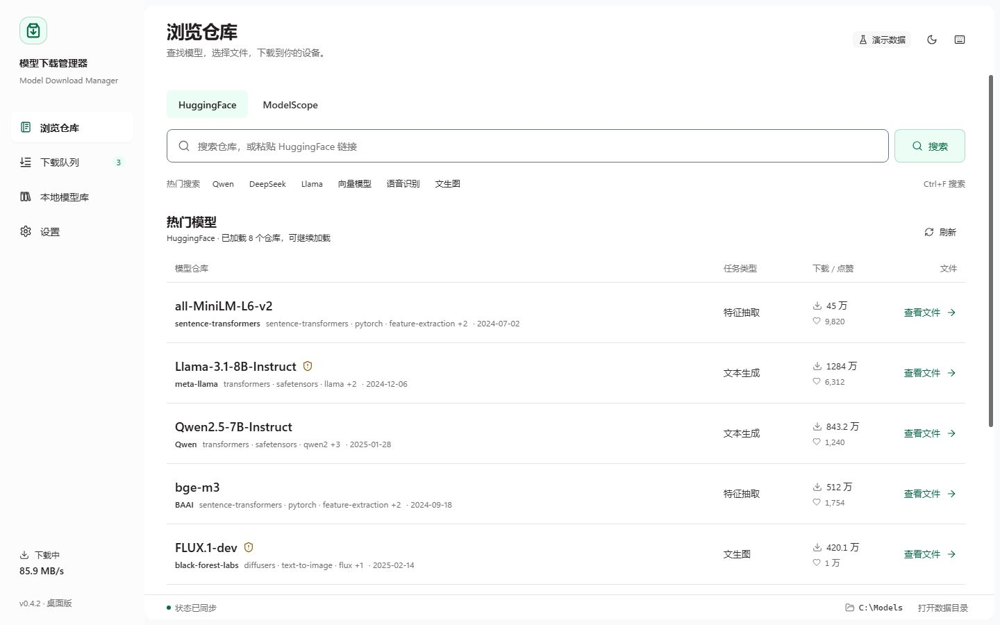
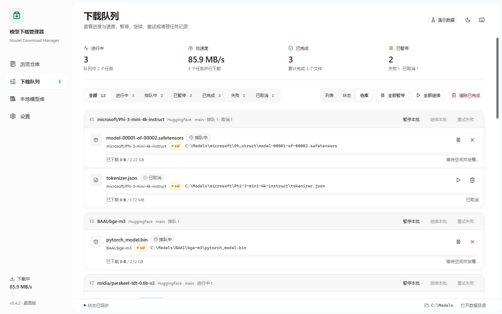
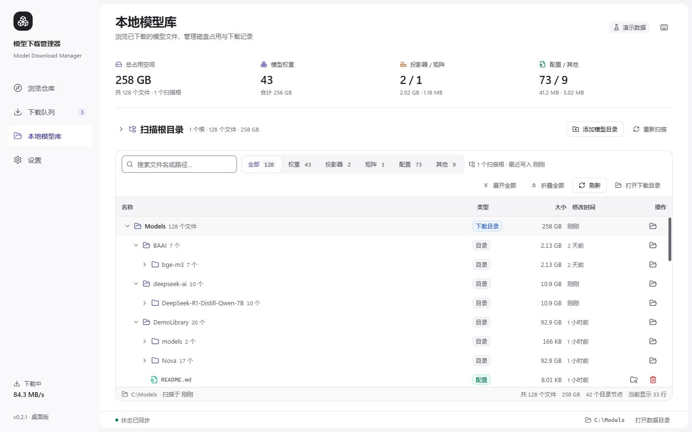
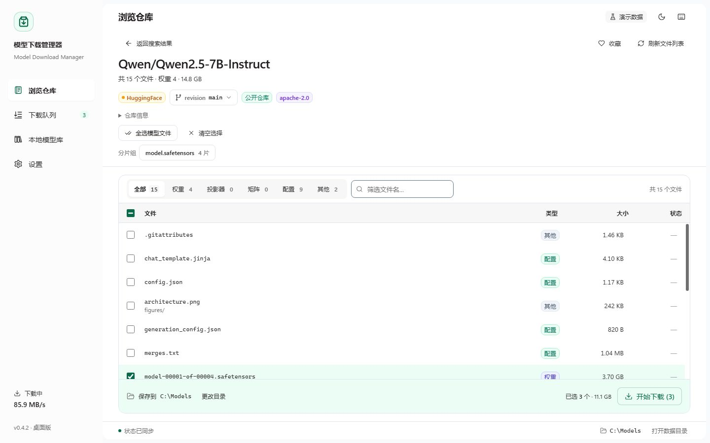
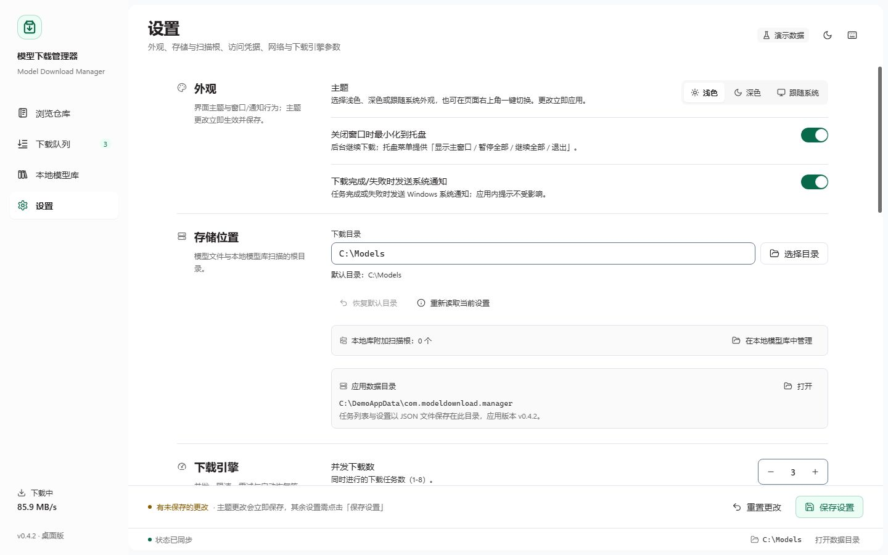
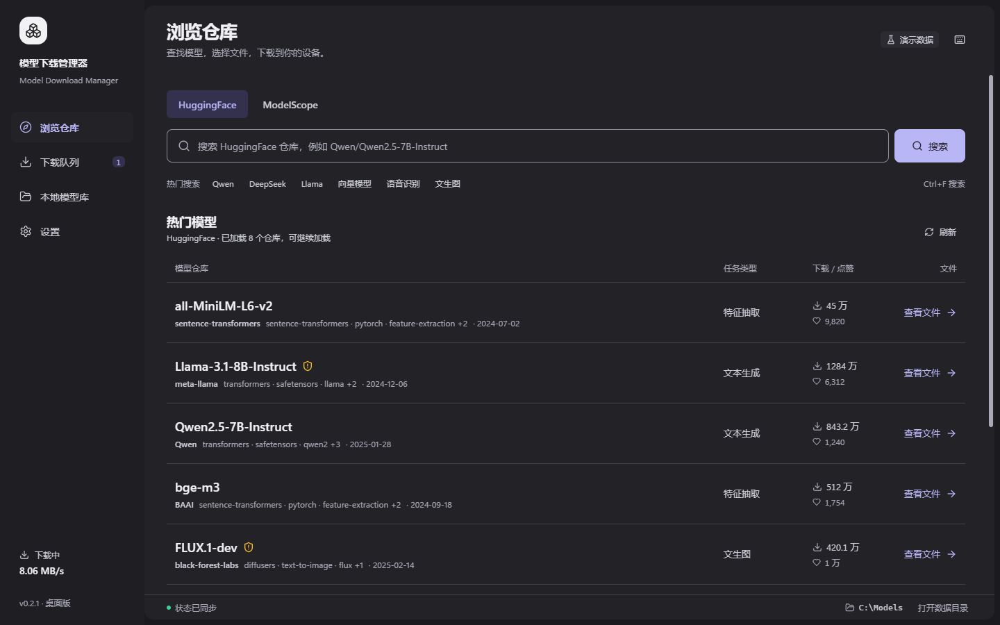
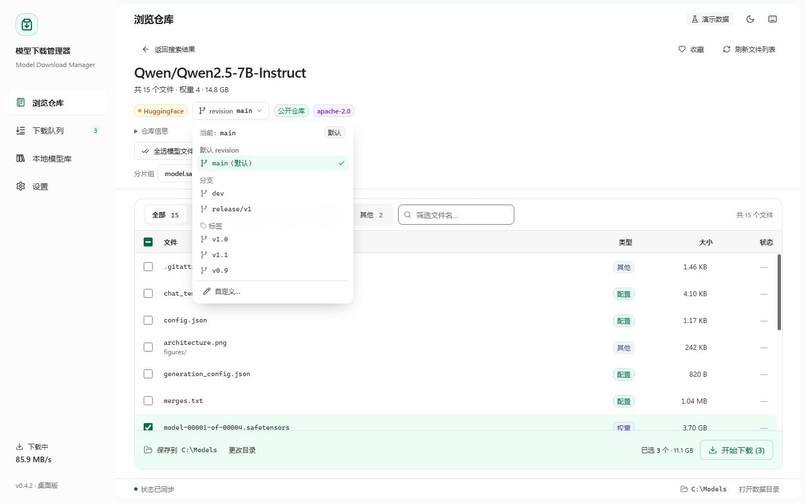

# 模型下载管理器（Model Download Manager）

[下载最新正式版（Windows x64）](https://github.com/jerrydong1988/model-download-manager/releases/latest) · [发布说明](docs/RELEASE-NOTES.md)

独立的模型权重下载管理桌面工具：从 **ModelScope** 与 **HuggingFace** 浏览仓库、多选文件、
排队下载，支持断点续传、暂停/继续、并发与限速、下载历史与本地模型库管理。
v0.1.3 起支持**暗色模式、托盘后台下载、系统通知、全局快捷键**，并完成整套 UI/UX 审计落地（Token 化、密度、无障碍）。
v0.1.4 修复下载任务状态竞态（任务实际在下载但队列显示「排队中 / 0 B/s」的问题）。
v0.2.0 新增**单文件多连接分段下载**（实测 4 连接提速 3.3–6.4 倍）、**多扫描根目录**、**仓库 revision（分支/标签）选择**、**通知点击跳转主窗口**。
v0.3.0 更新**雾白／石墨界面**与 **70 枚统一图标**，优化「浏览仓库 → 选择文件 → 批量下载」操作流程。
v0.4.0 支持按量化档选择、粘贴仓库链接、下载前磁盘检查、完成后校验，以及按仓库管理队列和本地收藏。
v0.4.2 将界面改为浅灰与薄荷绿，并在每个页面右上角一键切换浅色和深色。

> 项目从 `LlamaServerManager` 的下载模块中抽取、重构而来，本工具只专注「模型下载」这一件事。

> 下列截图展示当前 v0.4.2 界面。均由浏览器 Mock 模式生成，使用虚构示例路径与演示文件，不展示本机模型库或访问凭据。最新图标见 [完整图标目录](assets/icons/README.md)。



| 下载队列 | 本地模型库（演示数据） |
| --- | --- |
|  |  |

| 仓库文件选择 | 设置（外观/托盘/通知） |
| --- | --- |
|  |  |

| 暗色 · 浏览仓库 | 仓库 revision 选择 |
| --- | --- |
|  |  |

## 功能特性

图标系统包含 **70 枚统一 SVG（12 枚原创品牌／业务图形 + 58 枚 Lucide 通用图形）**，配套应用、托盘、PNG 和 Windows ICO 资源。参见[图标资源与用法](assets/icons/README.md)、[浅色总览](assets/icons/catalog-light.jpg)及[深色总览](assets/icons/catalog-dark.jpg)。

- **双数据源浏览**：HuggingFace / ModelScope 仓库搜索（分页加载）、仓库文件树浏览，自动分类为 权重 / 投影器 / 权重矩阵 / 配置 / 其他（`.hgn` 等特殊权重、`mmproj` 投影器、`imatrix` 矩阵均正确识别）；仓库详情支持 **revision 选择**（默认 / 分支 / 标签 / 自定义，v0.2.0）
- **多选下载**：文件列表可多选，并实时显示选中合计大小。同一仓库有多档量化时，默认只选推荐的一档和配套投影器，也可以改选其他档、按分片组选择或全选；只有一档时仍选中全部权重与投影器
- **可靠下载引擎**
  - **单文件多连接分段下载（v0.2.0）**：固定 16 MiB 分块 + 1–8 条 HTTP Range 连接并行（默认 4 条），CDN 单连接限速时显著提速；实测 ModelScope 单连接 12.6 MB/s，4 连接平均 41.4 MB/s、峰值 80.3 MB/s
  - 不支持 Range / 小文件 / 大小未知时自动回退单流；旧版单流 `.part` 断点升级后无损转分段继续
  - HTTP Range 断点续传（`.part` + `.part.json` 元数据校验；远端变更自动重下）；自动重试指数退避；完成后原子改名；已存在同尺寸文件自动跳过
  - 兼容 ModelScope「200 + Content-Range」的特殊续传语义与 hf-mirror 的 CDN 跳转
- **任务队列**：FIFO 排队、全局并发数 1–8 动态调整、全局限速（MB/s）、暂停 / 继续 / 取消 / 重试。同一来源、仓库和 revision 的任务收成一批，可整批暂停、继续或重试，整批结束后只发一条通知（v0.4.0）。不同 revision 的同名文件分别落盘；v0.2.1 起，新建的非默认 revision 使用独立目录
- **后台下载（v0.1.3）**：关闭窗口默认**最小化到托盘**，下载继续；再次打开（或再次双击快捷方式）恢复窗口并显示最新进度；托盘菜单支持显示窗口 / 暂停全部 / 继续全部 / 退出；退出前自动暂停并落盘任务
- **系统通知（v0.1.3 / v0.2.0）**：下载完成 / 失败发送 Windows 通知（可在设置关闭）；**点击通知可跳转并聚焦主窗口**；应用内 toast 附带「打开位置 / 重试」操作
- **持久化恢复**：关闭应用后任务保留，重新打开可继续（默认自动继续）
- **本地模型库（目录树视图）**：按真实目录层级展示历史模型（目录聚合大小 / 文件数 / 最近修改），支持搜索、类型筛选、展开/折叠、文件详情、打开位置与删除。展开和筛选会记在本机；同一相对路径出现在多个扫描根时标出重复；目录显示 revision；远程大小或校验和不同的文件标为「可更新」，不自动覆盖。可以清理取消后留下的 `.part`，不删除已完成文件。**多扫描根目录管理（v0.2.0）**：下载目录固定 + 最多 8 个附加模型目录，多根聚合统计与树节点分组；上千文件窗口化渲染不卡顿
- **外观**：浅色 / 深色 / 跟随系统三选一，重启保持、首帧不闪白（v0.1.3）。v0.4.2 起，每个页面右上角可一键在浅色与深色之间切换并立即保存；当前若是「跟随系统」，点一下会改成与当时外观相反的固定主题，要恢复跟随系统需回到「设置 → 外观」。界面为浅灰窗口、白色工作区和深薄荷绿强调，焦点环为靛蓝。内置 Noto Sans SC 可变字体（离线可用）
- **交互与无障碍（v0.1.3）**：全局快捷键、Skip link、完整键盘导航、可见焦点环、≥12px 字号与 AA 对比度、状态播报、错误摘要；`Ctrl+1..4` 切页、`Ctrl+F` 搜索、`F5` 刷新本页、`Ctrl+,` 设置、`?` 快捷键帮助
- **打开仓库**：搜索框接受仓库 ID，也可粘贴 HuggingFace 与 ModelScope 的仓库页、blob 和 resolve 链接；链接指向单个文件时会预选该文件（v0.4.0）
- **下载前检查与完成后校验（v0.4.0）**：目标盘放不下已选文件时不能开始下载；分段预分配后剩余空间低于 1 GB 时给出提示，仍允许继续。完成后保留 HuggingFace LFS oid 和 ModelScope 的 Sha256，在后台核对，不一致则标为失败并原地保留文件，移走冲突文件后可重试
- **最近打开与收藏（v0.4.0）**：只保存在本机，显示在浏览页，不需要账号
- **网络适配**：默认使用 HuggingFace 镜像 `hf-mirror.com`（国内可用），可切回官方；支持 HTTP/SOCKS 代理；可选平台 Token（gated / 私有仓库）
- **应用内在线升级（v0.5.0）**：启动自动检查新版本（可在设置关闭），发现新版时，可直接点击提示或侧栏的「立即升级」下载安装；设置页「关于与更新」手动检查、查看更新说明、一键下载安装并自动重启。更新包经 minisign 数字签名校验；更新源可指向镜像 `latest.json`（国内网络友好）。仅 NSIS 安装版支持，免安装版仍需手动替换

## 环境要求

- Windows 10/11（WebView2 运行时；Win11 自带，Win10 一般随 Edge 已安装）
- 开发：Node.js ≥ 18、npm、Rust ≥ 1.80（stable）、Visual Studio Build Tools（C++ 桌面开发）
- 打包：以上即可，`npm run tauri:build` 会自动下载 NSIS 工具

## 开发

```powershell
npm install
npm run tauri:dev        # 启动完整桌面应用（热更新）
```

仅调前端（浏览器 mock 模式，不需要后端）：

```powershell
npm run dev
# 打开 http://localhost:1420/?mock=1
```

Mock 模式支持深链与空态：`?mock=1&repo=Qwen/Qwen3-235B-A22B&source=huggingface`、`?mock=1&empty=1`；
本地库压力模式：`?mock=1&biglibrary=1`；下载通知：`&fast=1`；大量任务：`&bigtasks=1`；
组件画廊（开发用）：`http://localhost:1420/src/assets/ui-preview.html?theme=dark`。

校验与测试：

```powershell
npm run test:frontend    # 任务状态合并单元测试（Node 原生 test runner）
npm run check:ui         # 设计令牌对比度 + UI 规则静态检查
cd src-tauri; cargo test # 后端单元 + 本地 HTTP 集成回归（CI 运行）
```

## 构建安装包

```powershell
npm run tauri:build
# 免安装可执行文件：src-tauri\target\release\model-download-manager.exe
# NSIS 安装包：src-tauri\target\release\bundle\nsis\Model Download Manager_0.5.2_x64-setup.exe
```

正式发布须配置 minisign 签名密钥。CI 会验证安装包签名、版本和 `latest.json`，检查通过才发布。开发分支可构建无签名测试包。

```powershell
$env:TAURI_SIGNING_PRIVATE_KEY = (Get-Content "$HOME\.tauri\mdm-updater.key" -Raw)
$env:TAURI_SIGNING_PRIVATE_KEY_PASSWORD = (Get-Content "$HOME\.tauri\mdm-updater.key.password.txt" -Raw)
npm run tauri:build
node scripts/gen-update-manifest.mjs release-assets   # CI 发布时生成 latest.json
```

## 使用说明

1. 首次打开进入「设置」，确认下载目录（默认 `%USERPROFILE%\Documents\Models`）。页面右上角可一键切换浅色与深色；「外观」里仍可选择跟随系统，以及托盘与通知行为。
2. 进入「浏览仓库」，选择 HuggingFace 或 ModelScope，搜索模型名 / 组织名（如 `Qwen`、`deepseek`），也可直接输入仓库 ID 打开。
3. 点击仓库进入详情，或把仓库链接粘贴到搜索框。多档量化时默认只选推荐的一档和配套投影器，也可以改选其他档或全选。目标盘空间不足时不能开始下载。选择下载目录后点击「开始下载」。
4. 在「下载队列」中查看进度、速度与剩余时间。同一仓库的任务可以整批暂停、继续或重试；单个文件仍可暂停、取消或打开位置。文件会实时写入 `.part`，完成后自动改名，并在后台校验。
5. 下载完成后，默认分支的文件位于 `<下载目录>\<仓库ID>\<原文件路径>`；「本地模型库」可按目录树浏览、筛选与清理。标为「可更新」的文件不会自动覆盖。
6. 关闭窗口 = 最小化到托盘继续下载；需要完全退出时使用托盘菜单「退出」（会先暂停并保存任务状态）。

### Token（访问令牌）说明

Token 即平台访问令牌，作用等同 API-Key，**只用于私有仓库或需要授权（gated）的仓库，公开模型不需要填写**：

| 平台 | 获取地址 | 用途 |
|------|----------|------|
| HuggingFace | https://huggingface.co/settings/tokens （`hf_...`） | gated 仓库（Llama/Gemma 等需同意协议）、提高 API 限额 |
| ModelScope | https://modelscope.cn/my/myaccesstoken | 私有 / 受限仓库、提高 API 限额 |

Token 保存在本机应用数据目录 `%APPDATA%\com.modeldownload.manager\settings.json` 中，不会上传到任何第三方；事件与日志中不会输出 Token。

### HuggingFace 镜像（默认已开启）

本工具默认把 HuggingFace 端点设为 `https://hf-mirror.com`（国内可直连），可随时在「设置 → HuggingFace 端点」切回官方 `https://huggingface.co` 或自定义镜像。

### 代理

填写 `http://127.0.0.1:7890` 这类地址后，仓库请求与下载都走代理；留空则使用系统环境变量代理设置。

## 目录结构

```
src/                  React 前端（页面、组件、store、mock、字体资源）
src-tauri/src/        Rust 后端（数据源、下载引擎、队列、设置、本地库、桌面托盘/通知）
src-tauri/tests/      本地 mock HTTP server 集成测试（续传/416/5xx/暂停恢复）
docs/                 架构与 IPC 契约、设计令牌索引、第三方 API 实测、QA 报告、截图
design-system/        已取代的历史设计参考，当前规范见根目录 DESIGN.md
scripts/              图标生成、API 探测、UI 截图、对比度与 UI 规则校验脚本
tests/e2e/            端到端验收脚本（CDP 驱动真实应用）
```

## 开发文档

- [docs/ARCHITECTURE.md](docs/ARCHITECTURE.md) — 架构、模块所有权、可测试性要求
- [docs/IPC-CONTRACT.md](docs/IPC-CONTRACT.md) — 前后端 IPC 契约（命令 / 事件 / 类型 / 设置 / 托盘语义）
- [DESIGN.md](DESIGN.md) — 当前设计系统（v0.4.2 浅灰目录、深薄荷绿、靛蓝焦点环）
- [docs/DESIGN-TOKENS.md](docs/DESIGN-TOKENS.md) — 设计令牌与实现位置索引
- [docs/UI-AUDIT.md](docs/UI-AUDIT.md) — UI/UX 审计与优化方案（含 v0.1.3 实施结果）
- [docs/api-contracts.md](docs/api-contracts.md) — ModelScope / HuggingFace API 实测结论（含证据）
- [docs/QA-REPORT.md](docs/QA-REPORT.md) — 端到端验收报告（含 v0.1.3 托盘/通知/暗色复验）
- [docs/BACKEND-REVIEW.md](docs/BACKEND-REVIEW.md) — 后端独立审查与残余风险清单
- [design-system/model-download-manager/MASTER.md](design-system/model-download-manager/MASTER.md) — 历史设计系统基线

## 验收状态

v0.4.0 与 v0.4.2 的安装包由 GitHub Actions 在 Windows 上完成测试、编译、打包和 SHA-256 核对后发布。下面保留的是 v0.2.0 当时的验收记录，不代表后续版本的产物大小或测试计数。

### v0.2.0 记录

| 验证项 | 结果 |
|--------|------|
| 前端类型检查 / 生产构建 | ✅ `tsc --noEmit`、`vite build`（JS 344.77 kB / CSS 145.19 kB，字体 98 个 woff2 共 4.28 MB） |
| 后端测试 | ✅ **79/79 全绿**（62 单元 + 17 集成，含分段下载、旧 part 转换、revision、多根、分类、续传/重试、通知） |
| 前端任务合并 / 状态单测 | ✅ **20/20**（`npm run test:frontend`，含「过期 queued 响应覆盖 active」竞态回归） |
| 设计令牌 / UI 规则 | ✅ `check-contrast.mjs`（light/dark 全 AA）、`check-ui-rules.mjs` **0 违规** |
| **多连接分段下载（v0.2.0）** | ✅ 22/22：4 连接 sha256=curl、并发 Range 请求、暂停续传、不支持 Range 自动回退单流 |
| **旧断点无损兼容** | ✅ 大文件旧单流断点升级后不重下：前缀指纹一致、chunks 生成、续传正常（个人任务信息省略） |
| **真实提速实测** | ✅ 同一文件：单连接 12.6 MB/s → 4 连接 **平均 41.44 MB/s、峰值 80.31 MB/s**（3.3×/6.4×） |
| 多扫描根 / revision / 通知 | ✅ 33/33：多根持久化与树分组、非默认 revision 路径/去重/自定义、Windows 通知实拍 |
| 回归 | ✅ download 61/61、library 44/44、classification 37/37、ui-v013 38/38；本地目录扫描与分类回归通过（个人目录统计省略） |
| NSIS 安装包 | ✅ 静默安装 → 启动（version=0.2.0）→ 卸载 全通过 |

交付产物（v0.2.0）：
- 安装包：`src-tauri\target\release\bundle\nsis\Model Download Manager_0.2.0_x64-setup.exe`（6.50 MiB，SHA256 `A62D1E8B29D211EA87C88C9050020E229072E876987380F08CFFEFD196F156CD`）
- 免安装：`src-tauri\target\release\model-download-manager.exe`（9.73 MiB，SHA256 `1E3822534165187B986CF28BB7F5DB9D00FE13F74DB92B338942658A383E9A4B`）

## 更新日志

### v0.4.2

- 页面改为浅灰背景和白色工作区，当前导航、主按钮、进度和选中态使用薄荷绿，焦点环为靛蓝。
- 每个页面右上角可一键切换浅色与深色，并立即保存。设置中仍可选择跟随系统。
- 应用图标与托盘图标改为同一绿色。布局、下载流程和已有数据保持不变。

### v0.4.0

- 多档量化默认只选推荐的一档和配套投影器，并可按分片组选择；搜索框可粘贴 HuggingFace / ModelScope 链接。
- 开始下载前检查目标盘剩余空间；下载完成后后台校验 sha256，不一致则标为失败并原地保留文件，移走冲突文件后可重试。
- 下载队列按仓库聚合，整批结束只发一条通知。本地库记住展开与筛选，标出重复、revision 和可更新文件，并可清理残留 `.part`。
- 本机保存最近打开的仓库和收藏。旧配置、任务和下载路径无需迁移。

### v0.3.0

- 重设计浏览仓库、文件选择、下载队列、本地模型库与设置页面，采用雾白／石墨底色和蓝紫强调色。
- 文件选择突出整行状态，批量下载与设置操作保持可见；应用内通知自动避让底部操作区。
- 统一 70 枚界面图标（12 枚原创、58 枚 Lucide），更新应用、安装包、托盘与网页图标，提供 SVG／PNG／ICO 资源及离线预览。
- 保留浅色／深色／跟随系统、快捷键及现有下载功能；沿用 v0.2.1 的配置、任务和文件路径，无新增数据迁移。
- 发布附件由远端 Windows CI 完成测试、编译、打包和 SHA-256 校验。

### v0.2.1

- 修复功能审计发现的 11 项问题：下载完整性、路径冲突、限速卡死、停滞连接控制、revision 选择、快照与进度同步、磁盘根目录、SOCKS 代理。
- 新增 Windows CI 测试、编译、打包和稳定版发布，构建全部在 GitHub Actions 执行。
- 详细变更及升级兼容说明见 [v0.2.1 发布说明](https://github.com/jerrydong1988/model-download-manager/releases/tag/v0.2.1)。

### v0.2.0

- **单文件多连接分段下载**：设置「单文件连接数 1–8」默认 4；16 MiB 分块 + Range 并行、连接池、按块重试、暂停/取消/限速/进度与单流一致；不支持 Range/小文件/未知大小自动回退单流；**旧单流 `.part` 断点无损转分段继续**
- **实测提速**：ModelScope CDN 单连接 12.6 MB/s → 4 连接平均 41.44 MB/s、峰值 80.31 MB/s（同文件）；总连接数 ≈ 并发任务数 × 单文件连接数
- **本地库多扫描根目录**：下载目录 + 最多 8 个附加模型目录，根管理面板（添加/移除/统计/打开）、多根树节点、跨根统计；`LocalFile.rootDir`
- **revision 选择**：仓库详情可选择默认/分支/标签/自定义 revision 并重新加载文件；下载请求携带 revision；非默认 revision 落盘到 `{repoId}/{revision}/{path}`（默认 revision 路径与旧版完全一致）
- **通知点击跳转**：点击 Windows 通知正文显示并聚焦主窗口（Windows toast 在屏时生效；托盘左键始终可用）
- 契约/命令新增：Settings `connectionsPerFile`/`libraryRoots`、任务/请求 `revision`、命令 21 `list_revisions`、契约 §5.8
- 测试：后端 79/79（+22 新用例）、前端 20/20；新增 `resume-compat-v020`/`segment-v020`/`features-v020` 验收脚本

### v0.1.4

- **修复下载状态竞态**：`start_downloads` 返回的「排队中」快照可能晚于调度器的 `active` 事件到达前端，把状态覆盖回 queued，导致任务实际在下载但界面显示「排队中 / 0 B/s / 等待空闲并发槽」。修复：前端状态合并拒绝过期降级（active/pausing 不被 queued 覆盖、completed 为终态），并对 queued 任务的进度事件做**自愈**（收到前进进度即恢复 active）
- 新增 `src/lib/taskMerge.ts`（纯函数）+ `tests/frontend/task-merge.test.ts`（20 个回归用例，覆盖本次竞态）；新增 `npm run test:frontend`、`npm run check:ui` 脚本

### v0.1.3

- **UI/UX 审计落地（Phase 0–3）**：语义设计令牌（light/dark）、12px 最小字号与 AA 对比度、统一密度（顶栏 60 / 状态栏 28 / 侧栏 240 / 表格行 40）、扁平化组件、焦点环与全局键盘可达
- **暗色模式**：浅色 / 深色 / 跟随系统，重启保持、首帧不闪白；内置 Noto Sans SC 可变字体（离线）
- **托盘后台下载**：关闭窗口继续下载，单实例再次启动唤起窗口，托盘菜单显示/暂停全部/继续全部/退出，退出前暂停并落盘
- **系统通知**：下载完成/失败 Windows 通知（可关闭），应用内 Toast 带打开位置/重试操作
- **交互**：KeepAlive 页面状态保留、Skip link、路由焦点与播报、全局快捷键与帮助浮层、错误摘要、路径中间省略+复制、超长任务列表上限渲染
- **设置**：新增外观分组（主题/托盘/系统通知），保存条改为内联不遮挡

### v0.1.2

- 文件类型识别扩展：新增「投影器（mmproj）」与「权重矩阵（imatrix）」；`.hgn` 等特殊权重正确识别；`mmproj_config.json` 等不被误判

### v0.1.1

- 本地模型库重构为「文件管理器式目录树」，历史模型可按真实目录浏览

### v0.1.0

- 首个版本：双数据源浏览、多选下载、断点续传、任务队列、本地库、Token/镜像/代理设置

## 已知限制（v0.4.2）

- 多连接分段下载仅在远端支持 Range（且文件大小已知）时生效；小文件 / 不支持 Range 的源自动回退单连接（无提速）。ModelScope 公开 API 无 revision 列表（UI 提供自定义 revision 文本）；HF 镜像 `/refs` 可用。
- 多连接模式会把 `.part` **预分配为完整文件大小**（磁盘可用空间会先减少，完成/取消后释放）；35GB 文件约占用 35GB 临时空间。空间不足时不能开始下载，余量低于 1 GB 时会提示。
- 有效且远端版本一致的旧断点继续续传；元数据缺失/损坏或远端版本改变时从头下载。
- 新建非默认 revision 位于 `<下载目录>/.mdm-revisions/<revision 十六进制编码>/<仓库ID>/<文件路径>`；旧任务保留原保存路径，默认分支路径不变。
- 暂停/取消可中断连接建立、响应体和限速等待；读取空闲超时为 60 秒，无整个大文件下载的总时限。
- 强制结束进程（任务管理器）可能丢失最近最多 2 秒的任务状态；重启后未完成任务按暂停恢复（分段模式下已完成块不丢）。
- 托盘常驻期间只有一个实例；需要完全退出请使用托盘菜单「退出」（关闭窗口默认隐藏）。
- 系统通知显示受 Windows 通知设置/勿扰模式影响；**点击通知跳转仅在 toast 仍在屏幕时有效**（平台限制），托盘左键点击始终可唤起窗口；Linux/macOS 未做专项验证。
- `settings.json` 中 Token 为本地明文存储（仅保存在本机用户目录，不会外传）。
- 本地库的展开状态和筛选保存在本机。标为「可更新」的文件不会自动覆盖，大小未变时需要先删除本地文件再重新下载。
- 为离线可用内置了 Noto Sans SC 可变字体；安装包实际大小以发布附件为准。

## 技术栈

Tauri 2（Rust，托盘/单实例/系统通知/tokio 多连接分段下载）+ React 18 + TypeScript + Tailwind CSS + zustand；
下载引擎基于 tokio + reqwest 流式写入（v0.2.0 起支持单文件多连接 Range 分段）；字体 Noto Sans SC Variable（@fontsource）。

## 许可

[MIT](LICENSE)

## 公开资料维护

发布前运行 `npm run check:public`，检查个人主目录路径、常见凭据、运行数据和截图链接。该检查不能替代截图目视复核。

公开图库使用 `scripts/capture-public-screenshots.mjs` 连接专用浏览器与本地 Vite 服务，仅允许 Mock 模式。真实应用截图默认保存在 `.temp/private-screenshots`，不应提交到公开仓库。

旧断点真机验收脚本要求显式传入 `--repo`、`--file`、`--total` 和 `--baseline-mbps`；只使用已备份的测试任务。
